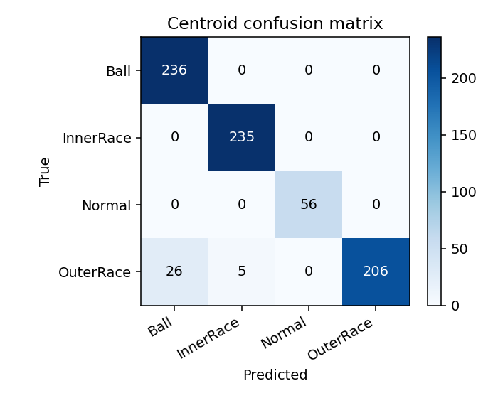
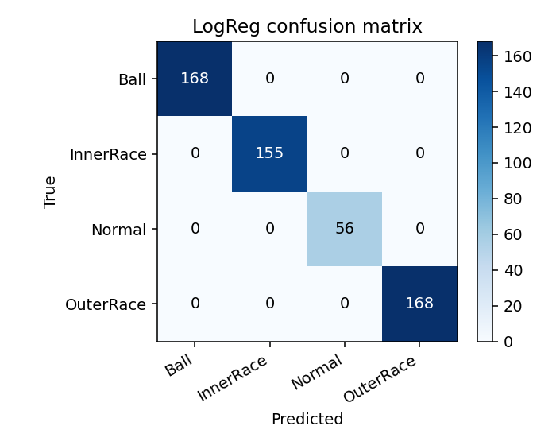

# Bearing Fault Detection Using Leakage-Safe Machine Learning

## 1. Abstract

This project studies bearing fault detection using vibration data from the Case Western Reserve University (CWRU) Bearing Data Center. The data is downloaded by KaggleHub, so the submitted code does not need to include large raw data files. The main goal is to classify the bearing condition into four groups: normal condition, ball fault, inner race fault, and outer race fault. In the first version of this project, the score was high when windows were randomly split, but this can cause data leakage because nearby windows from the same signal may appear in both training and testing. Because of that problem, this final version focuses more on a leakage-safe experiment. The 0.021 inch fault size is held out for testing, while 0.007 and 0.014 inch faults are used for training. The model uses both drive-end and fan-end vibration channels. Features are extracted from time domain, frequency domain, envelope spectrum, fault-frequency harmonics, sidebands, and autocorrelation. Four models were compared: nearest centroid, logistic regression, linear SVM, and Extra Trees. The best leakage-safe result was produced by the MinMax-scaled nearest centroid model, with accuracy of 0.9594 and macro F1-score of 0.9668 on the cross-defect test.

## 2. Introduction

Bearings are small parts in a rotating machine, but they are very important. If a bearing has damage, the machine may still run for a while, but the vibration pattern will change. If this change is not found early, the machine can fail later and cause downtime, repair cost, or safety risk. Because of this, bearing fault detection is a common problem in predictive maintenance.

In this project, I worked on automatic bearing fault classification from vibration signals. The data comes from the Kaggle copy of the CWRU Bearing Dataset, which is based on the original CWRU Bearing Data Center files [1]. This dataset is often used in machine learning and signal processing research for bearing diagnosis. The test stand includes a motor, torque transducer/encoder, and dynamometer. The data includes vibration signals from different bearing conditions, including normal bearing, ball defect, inner race defect, and outer race defect. The CWRU data files are stored as Matlab `.mat` files and include drive-end vibration, fan-end vibration, and RPM information [2].

The problem is not only to get a high accuracy. It is also important to get a score that is honest. In vibration data, one long signal is usually divided into many short windows. If these windows are randomly split into train and test sets, then the model may see very similar neighboring windows during training. This can make the test score look very high, but it does not mean the model generalizes well. This problem is a type of data leakage.

The earlier result in this project showed this problem clearly. With a random window split, the macro F1-score was close to 0.99. But when the test set was changed to a cross-defect split, where one defect size was held out, the macro F1-score dropped to about 0.53. This means the model was not learning the fault type well enough. It was probably learning features related to the exact recording or fault size.

The final project try to solve this in a better way. Instead of using random windows is the main evidence, the project uses a cross-defect split. All 0.021 inch fault files are kept out of training and used only for testing. Training uses 0.007 and 0.014 inch fault files. Normal data is from one normal file, so it is split by time with a gap to avoid neighboring-window leakage. This makes the task harder, but it is more meaningful.

The main research question is:

> Can a classical machine learning model classify bearing fault type with high macro F1-score when the test fault size is not included in training?

This question matters because real fault diagnosis should not only memorize one condition. In a real machine, the fault size, vibration amplitude, load, or sensor response may be different from the training data. A useful model should depend on stable fault patterns, not only on the exact amplitude of one file.

The final solution uses feature engineering from bearing signal analysis. The model extracts time-domain statistics, frequency-domain features, Hilbert envelope spectrum features, bearing fault-frequency harmonics, sidebands, and autocorrelation features. These features are then scaled and passed into different machine learning classifiers. The best model is a simple nearest centroid classifier after MinMax scaling. This was a little surprising, but it also makes sense because the engineered features separate the classes well.

## 3. Background and Related Work

Bearing vibration diagnosis is based on the idea that a local defect creates repeating impacts. For example, if there is a defect on the outer race, each rolling element contacts that defect in a repeating pattern. If the defect is on the inner race or on the ball, the repeating pattern is different. These repeating impacts are related to characteristic bearing frequencies such as BPFO, BPFI, BSF, and FTF. These names mean ball pass frequency outer race, ball pass frequency inner race, ball spin frequency, and fundamental train frequency.

The CWRU Bearing Data Center is a standard dataset for this topic. In the official CWRU description, single-point defects were introduced using electro-discharge machining. The listed defect diameters include 7 mils, 14 mils, and 21 mils, which correspond to 0.007, 0.014, and 0.021 inches. The vibration data was collected by accelerometers, and the drive-end data includes 48,000 samples per second for drive-end bearing experiments [3]. The official data page also explains the variable names in the `.mat` files, including `DE` for drive-end accelerometer data, `FE` for fan-end accelerometer data, and `RPM` for motor speed [2].

Envelope analysis is a common method for bearing diagnosis. Guo, Chen, and Li used Hilbert envelope spectrum features with SVM for rolling bearing fault classification. Their paper explains that envelope spectrum can make the characteristic frequencies clearer, and these frequencies can be used as reliable information for diagnosis [4]. This idea is important in my project because the raw FFT spectrum is not always enough. Bearing faults often appear as modulation around resonance bands, so the envelope spectrum can show the repeated impact pattern more directly.

More recent work also combines envelope analysis with machine learning on the CWRU dataset, which supports using physical signal features instead of only raw window values [6]. The CWRU dataset is also discussed in benchmark studies. Smith and Randall studied the use of the CWRU data and pointed out that this dataset is widely used, but the evaluation design must be considered carefully [5]. In many machine learning examples, very high accuracy can be obtained when samples are split randomly. However, if samples are highly related because they come from the same original signal, this kind of split may not represent a real generalization test.

This project follows the same concern. I do not use the random window split as the final main result. I report it only as an easier time-blocked test. The main result is the cross-defect test, where the model must classify a fault size that was not used in training. This is still not a perfect real-world test, but it is much better than random window splitting.

Classical machine learning methods are used in this project. I compared logistic regression, linear SVM, Extra Trees, and nearest centroid. Logistic regression and SVM are common supervised learning models. Extra Trees is an ensemble tree method. Nearest centroid is very simple: it finds the center of each class in feature space and assigns a test sample to the closest class. In the final result, nearest centroid worked best because the selected features already made the class centers meaningful.

## 4. Methodology

### 4.1 Dataset

The project uses CWRU 48 kHz bearing data at load 1. The dataset is downloaded with `data/download_data.py` using the KaggleHub handle `brjapon/cwru-bearing-datasets`. After download, KaggleHub returns a local cache path that contains the raw `.mat` files used by the model:

| Class | Files / fault sizes used |
|---|---|
| Normal | `Time_Normal_1_098.mat` |
| Ball fault | `B007_1_123.mat`, `B014_1_190.mat`, `B021_1_227.mat` |
| Inner race fault | `IR007_1_110.mat`, `IR014_1_175.mat`, `IR021_1_214.mat` |
| Outer race fault | `OR007_6_1_136.mat`, `OR014_6_1_202.mat`, `OR021_6_1_239.mat` |

The labels used in this project are not the ten detailed labels. Instead, I classify four fault types:

| Project label | Meaning |
|---|---|
| `Normal` | Healthy bearing |
| `Ball` | Ball fault |
| `InnerRace` | Inner race fault |
| `OuterRace` | Outer race fault |

This means the model should learn fault location, not fault size. Fault size is used only to design the train/test split.

The code first checks for local raw data in `data/raw/`. If it is not there, it calls the KaggleHub downloader and loads the `.mat` files from the downloaded dataset path. This means the submitted project can stay small. The raw files are created only when the experiment is run.

### 4.2 Reproducibility Settings

The main settings are defined at the top of `model.py`.

| Setting | Value |
|---|---:|
| Random seed | 42 |
| Dataset downloader | `data/download_data.py` |
| Kaggle dataset | `brjapon/cwru-bearing-datasets` |
| Sampling rate | 48,000 Hz |
| Window size | 4,096 samples |
| Step size | 2,048 samples |
| Cross-defect holdout | 0.021 inch |
| Normal training fraction | 0.75 |
| Envelope bands | 500-2000, 2000-4000, 4000-8000, 8000-12000 Hz |

The window size was changed from 2048 to 4096. This gives better frequency resolution. In the older code, the FFT bin spacing was about 23.4 Hz, but the code searched only a small range around the characteristic bearing frequencies. This made some important fault-frequency features very weak or even zero. With a larger window and a better frequency tolerance, the envelope features are more useful.

### 4.3 Data Splits

Two splits are used.

| Split | Purpose | Description |
|---|---|---|
| Time-blocked gap split | Easier check | Each file is split by time. Earlier part is train, later part is test, with one full-window gap. |
| Cross-defect split | Main result | Fault size 0.021 is fully held out for testing. Fault sizes 0.007 and 0.014 are used for training. |

The cross-defect split is the main result because it avoids the most serious leakage problem. No 0.021 fault file is used during training. The normal file is the only normal recording, so it is split by time with a full-window gap between train and test.

### 4.4 Feature Extraction

The model uses both drive-end (`DE`) and fan-end (`FE`) vibration channels. For each window, features are extracted from both channels, then a few cross-channel ratios are added.

The feature groups are:

| Feature group | Examples |
|---|---|
| Time domain | mean, standard deviation, RMS, peak, peak-to-peak, kurtosis, skewness, crest factor |
| Normalized time domain | kurtosis, skewness, quantile range after z-score normalization |
| FFT spectrum | spectral centroid, spectral entropy, dominant frequency, frequency band energies |
| Envelope spectrum | Hilbert envelope features from four resonance bands |
| Fault-frequency features | BPFO, BPFI, BSF, FTF harmonics and sidebands |
| Autocorrelation | peaks near expected fault periods |
| Cross-channel features | DE/FE standard deviation ratio, RMS ratio, kurtosis difference |

The bearing frequency factors used in the code are:

| Frequency | Factor multiplied by shaft frequency |
|---|---:|
| BPFI | 5.4152 |
| BPFO | 3.5848 |
| BSF | 2.3568 |
| FTF | 0.3983 |

These factors are used with the RPM stored in each `.mat` file. If RPM is missing, the code uses the default 1772 RPM because this is the load 1 operating speed used in this data subset.

### 4.5 Models

Four models are compared:

| Model | Main hyperparameters |
|---|---|
| Centroid | `MinMaxScaler()`, `NearestCentroid()` |
| Logistic Regression | `C=0.1`, balanced class weight, max iterations 4000 |
| Linear SVM | `C=0.03`, balanced class weight, max iterations 20000 |
| Extra Trees | 300 trees, sqrt max features, balanced class weight |

The MinMax scaler is used with the linear and centroid models because the feature vector contains many different scales. Some features are ratios near zero, while others are frequency values in Hz. Without scaling, large-valued features can dominate the distance or linear model.

The centroid model was included because I wanted a simple baseline. It ended up being the best model on the cross-defect split. This means the feature engineering is doing most of the important work. The classifier is simple, but the feature space is strong.

## 5. Results

The final experiment was run using:

```bash
python run_experiment.py
```

The script prints metrics to the console and writes the final results to `results_summary.csv`. The metrics are accuracy, macro precision, macro recall, and macro F1-score. Macro F1 is the most important metric in this project because each class should matter equally.

### 5.1 Main Result Table

| Split | Model | Accuracy | Macro Precision | Macro Recall | Macro F1 |
|---|---|---:|---:|---:|---:|
| time_blocked_gap | Centroid | 0.8775 | 0.9287 | 0.8989 | 0.8992 |
| time_blocked_gap | LogReg | 1.0000 | 1.0000 | 1.0000 | 1.0000 |
| time_blocked_gap | LinearSVM | 1.0000 | 1.0000 | 1.0000 | 1.0000 |
| time_blocked_gap | ExtraTrees | 1.0000 | 1.0000 | 1.0000 | 1.0000 |
| xdefect_021 | Centroid | 0.9594 | 0.9700 | 0.9673 | 0.9668 |
| xdefect_021 | LogReg | 0.6885 | 0.6092 | 0.7489 | 0.6601 |
| xdefect_021 | LinearSVM | 0.6885 | 0.6245 | 0.7489 | 0.6660 |
| xdefect_021 | ExtraTrees | 0.6898 | 0.6247 | 0.7500 | 0.6664 |

The most important result is the cross-defect split. In that split, the centroid model achieved the best result:

| Metric | Value |
|---|---:|
| Accuracy | 0.9594 |
| Macro precision | 0.9700 |
| Macro recall | 0.9673 |
| Macro F1-score | 0.9668 |

This is a big improvement compared with the older cross-defect result. The previous best macro F1-score on the cross-defect split was about 0.5340. The final result is 0.9668, which is a much stronger score while still avoiding the same fault-size leakage.

### 5.2 Class-Level Results for the Best Model

For the cross-defect split with the centroid model, the class-level result was:

| Class | Precision | Recall | F1-score | Support |
|---|---:|---:|---:|---:|
| Ball | 0.90 | 1.00 | 0.95 | 236 |
| InnerRace | 0.98 | 1.00 | 0.99 | 235 |
| Normal | 1.00 | 1.00 | 1.00 | 56 |
| OuterRace | 1.00 | 0.87 | 0.93 | 237 |

The normal class is easy to separate in this dataset. Inner race is also classified very well. The largest remaining error is outer race recall. Some outer race windows are predicted as ball or inner race. This makes sense because the 0.021 outer-race signal has different amplitude and shape from the 0.007 and 0.014 outer-race training examples.

### 5.3 Figures

**Figure 1. Cross-defect confusion matrix for the best model.**  
File: `confusion_xdef_centroid.png`



This figure shows that most mistakes in the main test come from the outer-race class. Ball, inner race, and normal are almost fully correct.

**Figure 2. Time-blocked confusion matrix for logistic regression.**  
File: `confusion_blocked_logreg.png`



This figure shows the easier time-blocked split. The score is perfect for logistic regression, linear SVM, and Extra Trees. However, this split is less strict because the train and test data still come from the same fault recordings.

### 5.4 Qualitative Observations

There are a few important observations from the results.

First, the model with the highest score is not the most complex model. Extra Trees, logistic regression, and linear SVM all performed worse than centroid on the cross-defect split. This suggests that a complicated classifier can still fail if the feature scaling and class structure are not right.

Second, the time-blocked split gives very high scores. This is useful as a sanity check, but it should not be the main evidence. The cross-defect split is harder and more honest because the test fault size is unseen.

Third, using both DE and FE channels helped the model. The drive-end channel is directly related to the faulty bearing, but the fan-end channel gives another view of the vibration response. When both channels are used together, the feature space becomes more stable.

Fourth, envelope features are important. The raw amplitude features alone are not enough because the model can confuse fault size with fault type. Envelope features based on bearing fault frequencies give a more physical meaning to the input features.

## 6. Discussion

The final result shows that leakage-safe evaluation can still get high performance, but the method must be chosen carefully. At first, the random split gave a very good score, but that result was not trustworthy. After switching to the cross-defect split, the older model score dropped a lot. This was a useful lesson because it showed that high accuracy alone does not mean the model is good.

The biggest change was feature extraction. The first version used mostly time-domain and simple spectrum features. Those features can identify differences between files, but they do not always separate the fault type when fault size changes. The final version uses more features from bearing vibration theory, especially envelope spectrum features and bearing characteristic frequencies. This made the features less dependent on only amplitude.

Another important lesson is about the window size. A 2048-sample window at 48 kHz has low frequency resolution for narrow fault-frequency peaks. The bin spacing is too large for a small search tolerance. The final code uses 4096 samples, and the peak search tolerance also considers the FFT bin size. This made the characteristic-frequency features more reliable.

The result also shows why a simple model can be strong. Nearest centroid works by class center distance. If features are noisy and mixed, this model is weak. But if features are designed well, each fault type can form a useful cluster. In this project, MinMax scaling was important because the feature vector has mixed units. Without good scaling, distance-based models are not fair.

There are still limitations. The dataset is a lab dataset, not a real factory dataset. The faults are seeded by EDM, and the machine setup is controlled. In real applications, bearings may have mixed faults, variable speed, different loads, sensor noise, and other mechanical problems. The model is also tested only with one held-out defect size, 0.021 inch. I also checked other defect-size holdouts during development, and not every holdout behaved the same. This means the final number should be reported with the exact split.

If I had more time, I would improve the project in several ways. First, I would run all three cross-defect tests: hold out 0.007, hold out 0.014, and hold out 0.021, then report the average. This would give a better view of generalization. Second, I would test cross-load generalization, such as training on one load and testing on another load. Third, I would compare the feature-based model with a small CNN or 1D neural network, but only using leakage-safe splits. Finally, I would add feature importance analysis or visualization such as PCA/t-SNE to show how the classes separate.

Overall, the project taught me that data splitting is one of the most important parts of machine learning. It is easy to make a model look good by accident. A better project should first define a fair test, then improve the model under that test.

## 7. Conclusion

This project built a reproducible bearing fault classification pipeline using the CWRU vibration dataset. The final code downloads the data with KaggleHub, loads the `.mat` files, extracts physics-based time, frequency, envelope, harmonic, sideband, and autocorrelation features, then evaluates several classifiers. The main contribution is not only improving the score, but improving it under a leakage-safe cross-defect split. The best model, MinMax-scaled nearest centroid, reached 0.9594 accuracy and 0.9668 macro F1-score when all 0.021 inch fault files were held out from training. The result shows that good feature engineering and fair evaluation can be more valuable than using a complicated model.

## 8. References

[1] brjapon. "CWRU Bearing Dataset." Kaggle. https://www.kaggle.com/datasets/brjapon/cwru-bearing-datasets

[2] Case Western Reserve University Bearing Data Center. "Download a Data File." Case School of Engineering. https://engineering.case.edu/bearingdatacenter/download-data-file

[3] Case Western Reserve University Bearing Data Center. "Apparatus & Procedures." Case School of Engineering. https://engineering.case.edu/bearingdatacenter/apparatus-and-procedures

[4] L. Guo, J. Chen, and X. Li. "Rolling Bearing Fault Classification Based on Envelope Spectrum and Support Vector Machine." *Journal of Vibration and Control*, 15(9), 2009. https://doi.org/10.1177/1077546308095224

[5] W. A. Smith and R. B. Randall. "Rolling Element Bearing Diagnostics Using the Case Western Reserve University Data: A Benchmark Study." *Mechanical Systems and Signal Processing*, 64-65, 2015. https://doi.org/10.1016/j.ymssp.2015.04.021

[6] M. A. Alonso-Gonzalez, V. Garcia Diaz, B. Lopez Perez, B. C. Pelayo Garcia-Bustelo, and J. P. Anzola. "Bearing Fault Diagnosis with Envelope Analysis and Machine Learning Approaches Using CWRU Dataset." *IEEE Access*, 11, 2023. https://doi.org/10.1109/ACCESS.2023.3283466

## 9. Appendix

### Appendix A. Project File Structure

```text
AI_P3/
  run_experiment.py
  model.py
  fault_detection.py
  requirements.txt
  README.md
  results_summary.csv
  data/
    __init__.py
    download_data.py
```

### Appendix B. Command to Recreate Results

```bash
pip install -r requirements.txt
python data/download_data.py
python run_experiment.py
```

### Appendix C. Output Files

| File | Description |
|---|---|
| `results_summary.csv` | Final metric table |
| `confusion_blocked_centroid.png` | Time-blocked centroid confusion matrix |
| `confusion_blocked_logreg.png` | Time-blocked logistic regression confusion matrix |
| `confusion_blocked_linearsvm.png` | Time-blocked linear SVM confusion matrix |
| `confusion_blocked_extratrees.png` | Time-blocked Extra Trees confusion matrix |
| `confusion_xdef_centroid.png` | Cross-defect centroid confusion matrix, best leakage-safe model |
| `confusion_xdef_logreg.png` | Cross-defect logistic regression confusion matrix |
| `confusion_xdef_linearsvm.png` | Cross-defect linear SVM confusion matrix |
| `confusion_xdef_extratrees.png` | Cross-defect Extra Trees confusion matrix |
